<!-- cool-readme:start -->
<!-- Cards by github-cool-readme: https://github.com/pedrocatalao/github-cool-readme -->

<picture>
  <source media="(prefers-color-scheme: dark)" srcset="https://raw.githubusercontent.com/mazzottti/mazzottti/cards/about-dark.svg">
  
</picture>
<picture>
  <source media="(prefers-color-scheme: dark)" srcset="https://raw.githubusercontent.com/mazzottti/mazzottti/cards/languages-dark.svg">
  
</picture>

<picture>
  <source media="(prefers-color-scheme: dark)" srcset="https://raw.githubusercontent.com/mazzottti/mazzottti/cards/summary-dark.svg">
  
</picture>
<picture>
  <source media="(prefers-color-scheme: dark)" srcset="https://raw.githubusercontent.com/mazzottti/mazzottti/cards/weekly-dark.svg">
  
</picture>

<picture>
  <source media="(prefers-color-scheme: dark)" srcset="https://raw.githubusercontent.com/mazzottti/mazzottti/cards/streaks-dark.svg">
  
</picture>

<!-- cool-readme:end -->
